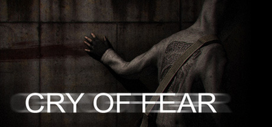

<p align="center">
  
</p>

<p align="center">
  
</p>

<h1 align="center">Cry of Fear Web</h1>

<p align="center">
  Horror psicológico en el navegador · Alpha no oficial · Sin fines de lucro<br>
  <strong>WebAssembly · WebGL 2 · Xash3D FWGS</strong>
</p>

<p align="center">
  <a href="https://putrefacto669.github.io/Cry-Of-Fear-PortWeb/"><strong>▶ JUGAR LA ALPHA</strong></a>
  &nbsp;·&nbsp; <a href="#estado-real-del-port">Estado del port</a>
  &nbsp;·&nbsp; <a href="#controles">Controles</a>
  &nbsp;·&nbsp; <a href="#ejecutar-en-local">Ejecutar en local</a>
  &nbsp;·&nbsp; <a href="#créditos-y-permisos">Créditos</a>
</p>

> **Una Alpha en construcción.** Este proyecto adapta Cry of Fear a navegadores de escritorio
> conservando sus recursos y mecánicas originales. No es un lanzamiento oficial de Team Psykskallar
> ni una campaña completa certificada como jugable de principio a fin.
>
> Esta distribución es **`636f6f29424d`**: conserva la corrección de vida/energía para Gecko,
> incorpora la presentación original comprobada de la Glock y permite elegir entre siete idiomas
> al entrar al launcher. Los cargadores individuales de `AmmoInv` y el HUD de otras armas siguen pendientes.

## Estado real del port

| Sistema | Estado y alcance |
|---|---|
| Motor y renderizado | Xash3D FWGS en WebAssembly y WebGL 2; cliente, servidor y renderizador separados. |
| Mapas | **11 mapas preparados** del prólogo, preludio y primer capítulo. Empaquetado no equivale a recorrido natural completo. |
| Teléfono y combate | Teléfono, navaja y Glock; combinaciones con el teléfono y puñetazo de un jugador comprobados. |
| Equipo | Cámara digital y morfina, con los límites de sus informes de validación. |
| Inventario | Bolso, selección rápida, llaves y objetos de progresión implementados. |
| Persistencia | Pruebas de guardado/carga, callbacks, cámaras, entidades móviles, voces e inventario. |
| HUD | Vida y energía compatibles con Gecko; indicador original de Glock probado en Chromium y Firefox. Cargadores individuales de AmmoInv pendientes. |
| Extras | Comentarios, ropa y visión nocturna con pruebas específicas; no implica desbloquearlos automáticamente. |
| Idiomas | Siete idiomas originales de subtítulos. Selector inicial del launcher en los mismos siete idiomas; recuerda la elección sin cambiar las preferencias del juego. |
| Próximos capítulos | Más armas, mapas y validación de progresión; distribución inmutable probada únicamente en localhost. |

Las recogidas parciales de **FAMAS, MP5A3, Axe y Simon’s Book** no significan que esas armas estén
completamente implementadas. El siguiente arsenal de historia debe reconstruirse y probarse con
su contrato original; no se sustituye por armas de Half-Life con otra apariencia.

La ruta principal de pruebas utiliza Chromium. La presentación de las barras se comprobó también
con Firefox/Gecko; eso no certifica toda la campaña en cada navegador. **Android/iOS y controles
táctiles todavía no están acreditados con dispositivos físicos.**

## Antes de jugar

- Usa un ordenador con **teclado, ratón y WebGL 2**.
- La descarga depende del mapa y de lo que ya conserve la caché. No hace falta instalar Steam
  ni una DLL nativa para jugar a la versión web.
- Las partidas permanecen en **este navegador y este origen**. No existe sincronización en la nube.
- Guarda mediante la grabadora original antes de aceptar **«Nueva versión · recargar»**.
- No borres los datos del sitio para actualizar: también podrías borrar tus partidas.

El bloqueo intermitente de `registration.update()` sigue investigándose. Las comprobaciones
públicas satisfactorias no se presentan como una garantía de actualización en todas las sesiones.

## Controles

| Entrada | Acción |
|---|---|
| **W A S D** | Moverse |
| **Shift** | Correr |
| **Ctrl / C** | Agacharse |
| **Espacio** | Saltar |
| **E** | Usar y recoger |
| **Tab** | Abrir/cerrar el bolso |
| **1 · 2 · 3** | Selección rápida |
| **F** | Linterna, según el equipo y su estado |
| **R** | Recargar |
| **Clic izquierdo / derecho** | Ataque y acción secundaria del equipo actual |
| **Esc** | Menú y liberación del ratón |

La lista de referencia vive en [cof_web.cfg](platform/game/cof_web.cfg). La disponibilidad de
cada acción depende del arma, la escena y las reglas del juego original.

## Idiomas

**Español · English · Français · Deutsch · Nederlands · Norsk · Svenska**

El launcher presenta estos siete idiomas al entrar por primera vez al launcher y permite
cambiarlos después con su botón de idioma. La preferencia del launcher se guarda por separado:
los subtítulos y textos originales del juego se eligen en su propio menú.

## Ejecutar en local

Para probar la distribución ya preparada:

```powershell
git clone https://github.com/Putrefacto669/Cry-Of-Fear-PortWeb.git
cd Cry-Of-Fear-PortWeb
python tools/serve.py dist --port 8080
```

Abre [localhost:8080](http://localhost:8080/). Se necesita un servidor HTTP; abrir `index.html`
con `file://` no reproduce las condiciones del juego web. La descarga del repositorio es grande
porque `dist/` contiene la distribución autorizada y versionada.

## Compilar y preparar recursos

Para desarrollo se utilizan WSL2, Python, Emscripten y los clones de Xash3D FWGS/hlsdk-portable.
El staging lee una instalación local autorizada de Cry of Fear; **no modifica los originales**.

```powershell
wsl -- bash "<repo-WSL>/tools/wsl/setup_toolchain.sh"
wsl -- bash "<repo-WSL>/tools/wsl/patches.sh" apply
wsl -- bash "<repo-WSL>/tools/wsl/build_engine.sh"
wsl -- bash "<repo-WSL>/tools/wsl/build_game.sh"
wsl -- bash "<repo-WSL>/tools/wsl/build_tools.sh"
```

Preparar un mapa y empaquetar:

```powershell
wsl -- python3 "<repo-WSL>/tools/stage_map.py" "<juego-original-WSL>" c_start /root/cof-web/stage --texcomp /root/cof-web/build/tools/texcomp
wsl -- bash "<repo-WSL>/tools/wsl/package.sh"
```

`<repo-WSL>` representa la ruta completa del repositorio vista desde Linux. El empaquetado deja
por defecto una carpeta privada en `~/cof-web/dist`; no debe copiarse sobre la distribución
principal ni publicarse sin revisar y autorizar el resultado.

## Validación y depuración

| Área | Herramientas o evidencia |
|---|---|
| Navegador y caché | [tools/e2e](tools/e2e), [build/validation](build/validation) |
| Corrección de barras en Gecko | [Diagnóstico](docs/HUD_GECKO_2026_11_04.md) · [Publicación verificada](docs/PUBLICACION_HUD_2026_11_04.md) |
| Publicación actual | [Distribución y comprobaciones públicas](docs/PUBLICACION_ALPHA_HUD_IDIOMAS_2026_11_04.md) |
| HUD de munición y siete idiomas del launcher | [Implementación, pruebas y límites](docs/HUD_MUNICION_Y_LAUNCHER_2026_11_04.md) |
| Armas y prioridades de historia | [Variante SP y arsenal](docs/VARIANTE_UN_JUGADOR_Y_ARMAS_2026_11_02.md) |
| Persistencia de extras | [Informe de extras](docs/EXTRAS_2026_11_02.md) |
| Memoria y errores nativos | `tools/wsl/build_asan.sh`, `build_native_asan.sh`, `leak_growth.sh` |

`?debug=1` activa las herramientas conservadas de diagnóstico. Los comandos de prueba no se
utilizan para acreditar progresión natural. Se distinguen pruebas de presentación, contratos de
entidades, ejecuciones con WASM y recorridos manuales; una compilación correcta no sustituye la
validación del juego.

## Estructura

```text
platform/web/      launcher, HUD, loader, Service Worker y shaders
game/cof-logic/    lógica y adaptaciones propias de Cry of Fear
patches/           integración con Xash3D FWGS y hlsdk-portable
tools/             staging, builds, análisis y pruebas
docs/              informes, límites y decisiones de compatibilidad
dist/              Alpha autorizada y preparada para servir
build/validation/  resultados conservados de ejecuciones y regresiones
```

## Publicación

[GitHub Pages](https://putrefacto669.github.io/Cry-Of-Fear-PortWeb/) publica `dist/` mediante
[el workflow existente](.github/workflows/pages.yml), al actualizar esos archivos en `main`.
Actions no recompila el juego: sube los bytes previamente verificados. Todos los cambios de
publicación requieren autorización; las pruebas experimentales permanecen separadas.

La ampliación de capítulos requiere revisar espacio, retención y coherencia de versiones. No se
promete que la campaña completa quepa en el alojamiento actual ni se cambia el proveedor como
parte de una corrección de jugabilidad.

## Créditos y permisos

- **Cry of Fear, Simon y los recursos originales:** © **Team Psykskallar**, Andreas Rönnberg y equipo.
  [Sitio del juego](http://www.cry-of-fear.com/). Este port se publica con permiso de su autor;
  **no es un producto oficial**.
- **Xash3D FWGS:** motor compatible con GoldSrc, por el equipo [FWGS](https://github.com/FWGS/xash3d-fwgs).
- **hlsdk-portable:** adaptación portable del SDK de Valve, por FWGS.
- **Emscripten, SDL2 y stb_dxt:** herramientas y dependencias de la implementación web.
- **Port web:** Putrefacto669, con las contribuciones documentadas en el repositorio.

El permiso de publicación exige **créditos visibles, código abierto y ausencia de monetización**:
sin anuncios, donaciones, pagos ni muros de pago, también en forks que reutilicen los recursos.
Un fork necesita su propio permiso de Team Psykskallar; el de este proyecto no se transfiere.

El arte promocional de Simon y el logo conservan su autoría. Véase
[la procedencia de las imágenes](docs/images/README.md).

## Licencias

| Parte | Condiciones |
|---|---|
| Código propio del port y herramientas | [GPL-3.0](LICENSE) |
| Xash3D FWGS y sus parches | GPL-3.0, conforme al motor |
| hlsdk-portable y sus adaptaciones | Licencia del Half-Life 1 SDK de Valve; conservar sus avisos |
| Mapas, modelos, texturas, sonidos, música e imágenes originales | © Team Psykskallar; **no son GPL**. Se conservan las condiciones del permiso de distribución |
| `tools/texcomp/stb_dxt.h` | Dominio público |
| Emscripten / SDL2 | MIT/UIUC / zlib, según cada componente |

El cliente y el servidor se cargan como módulos separados. La licencia del código del repositorio
no sustituye las licencias del SDK, el motor o los recursos del juego.
