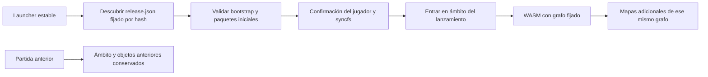

# Propuesta: paquetes inmutables para los siguientes capítulos

Documento de diseño, sin cambios en los recursos publicados, el alojamiento ni el motor. Complementa la investigación de `ServiceWorkerRegistration.update()`; versionar paquetes no demuestra ni soluciona por sí solo el atasco de esa API.

## Unidad de versión

Cada lanzamiento identifica un grafo completo de frontend, motor, cliente, servidor, renderizador y paquetes. El lanzamiento fija todos sus recursos antes de arrancar WASM. Un archivo ausente o incorrecto produce un error recuperable; no se sustituye por el de otro lanzamiento.

Se mantienen los paquetes actuales de Emscripten (`engine`, `boot`, compartidos y paquetes por mapa). No hace falta transformar los BSP ni los archivos originales. El JS de metadatos y su `.data` se tratan como una pareja indivisible: sus offsets y longitudes pertenecen al mismo paquete.

Estructura de URLs propuesta:

```text
/latest.json                                  # descubrimiento, nunca fija una partida activa
/releases/<release-id>/release.json            # manifiesto inmutable completo
/releases/<release-id>/index.html
/releases/<release-id>/sw.js
/releases/<release-id>/loader.js
/objects/sha256/<hash-transporte>/engine.data.gz
/objects/sha256/<hash-metadatos>/engine.js
/objects/sha256/<hash-transporte>/map_c_apartment1.data.gz
```

`release-id` deriva de una representación canónica del manifiesto de recursos y su versión de esquema. El manifiesto no se incluye a sí mismo en el cálculo. Tampoco se intenta calcular un punto fijo introduciendo el ID en un archivo cuyo hash contribuya a ese mismo ID. Un bootstrap generado puede contener el ID y quedar identificado por una segunda envoltura de publicación.

`latest.json` apunta a un manifiesto por URL y SHA-256 completo. Los nombres lógicos se separan de las URLs físicas: `/lib/server.wasm` sigue siendo el nombre que monta el SDK, aunque su paquete provenga de una URL inmutable.

Ejemplo conceptual de una entrada:

```json
{
  "logical": "packs/engine.data",
  "url": "/objects/sha256/<sha256-wire>/engine.data.gz",
  "encoding": "gzip",
  "wireBytes": 959538,
  "wireSHA256": "<sha256-wire-completo>",
  "decodedBytes": 2876888,
  "decodedSHA256": "<sha256-original-completo>",
  "metadata": "<id-del-JS-de-offsets>"
}
```

Los números solo ilustran el esquema con el paquete existente; no son una promesa de tamaño para capítulos futuros. Se comprueban tanto el transporte como el contenido descomprimido. No se depende de un prefijo de doce caracteres para la nueva representación.

## Activación y aislamiento de partidas

La opción preferida es un ámbito de Service Worker por lanzamiento, bajo `/releases/<release-id>/`. Las pestañas antiguas continúan en su ámbito y sus URLs. El nuevo worker no reclama globalmente las partidas de otra versión. El jugador guarda, acepta la actualización y navega al nuevo lanzamiento cuando corresponde.



La primera migración desde el worker histórico de ámbito raíz necesita un paso explícito: instalar y confirmar el worker del ámbito nuevo antes de navegar a él. Así se evita que el manejador histórico de navegación devuelva su `index.html` bajo una URL nueva. Registrar un ámbito distinto tampoco debe presentarse como una solución demostrada del atasco de `update()`; es una decisión de aislamiento de lanzamientos.

## Caché, descargas y recuperación

- El catálogo de descubrimiento usa revalidación o `no-store`. Nunca cambia el grafo de una partida ya iniciada.
- Los objetos y manifiestos inmutables pueden usar una caché prolongada. Una URL que identifica bytes no se sobrescribe.
- La preparación valida primero el conjunto necesario para iniciar: frontend, módulos, boot, compartidos y mapa solicitado. No necesita descargar toda la campaña para jugar el primer mapa.
- Cada nuevo mapa se descarga por sus URLs fijadas. La publicación siguiente no modifica ese destino.
- Una descarga truncada no se marca como válida. El reintento usa la misma URL y el mismo hash; no intenta cargar un paquete actual bajo el identificador antiguo.
- Un marcador de lanzamiento preparado se escribe solo después de comprobar las dependencias iniciales. Los objetos ya verificados pueden reutilizarse entre lanzamientos.
- La limpieza local conserva lanzamientos con clientes activos. La política del servidor debe retener los objetos de lanzamientos todavía soportados; cambiar la caché del navegador no recupera un objeto que el servidor haya eliminado.

La deduplicación inicial es por paquete completo. Dividir en objetos de menor tamaño requiere un estudio posterior de referencias compartidas y del montador; no se propone reescribir ahora el cargador ni multiplicar peticiones por cada modelo o sonido.

## Guardados y compatibilidad

El formato `.sav` y los callbacks nativos no se cambian para implantar esta distribución. Se conserva el origen web y se documenta expresamente el nombre de la base IDBFS: cambiar de ruta de lanzamiento no debe crear accidentalmente otra base vacía.

Antes de la navegación se espera a la sincronización de `/rwdir`, se comprueba el resultado y se mantiene la partida si falla. Un identificador de lanzamiento y de compatibilidad puede guardarse en metadatos web separados del archivo nativo. La compatibilidad entre dos versiones del SDK debe probarse; el hash de un paquete no demuestra compatibilidad de partidas.

Para evitar dos escritores simultáneos sobre el mismo perfil, el launcher debe coordinar el acceso a almacenamiento, por ejemplo mediante un bloqueo web por perfil. No basta serializar dos transacciones si ambas intentan sobrescribir el mismo slot desde estados de juego diferentes. Un segundo lanzamiento puede esperar al cierre del escritor anterior o usar un perfil independiente elegido por el jugador. No se modifica silenciosamente la partida para permitir coexistencia.

## Implantación propuesta, pendiente de autorización

1. Generar un catálogo de hashes completos sobre los paquetes actuales en una carpeta de prueba. Verificar la pareja metadatos/datos, sin cambiar el empaquetado nativo.
2. Probar dos ámbitos y dos lanzamientos en localhost, con una partida anterior abierta, un guardado real, errores de descarga y reapertura del navegador.
3. Diseñar y medir la retención, el espacio y la descarga por capítulos. Elegir capacidades HTTP de un almacenamiento de objetos/CDN; no se elige ni se migra ahora un proveedor.
4. Ensayar la migración desde el worker raíz y las partidas existentes. Mantener el sitio actual disponible durante el ensayo.
5. Publicar únicamente después de revisar esa migración y autorizar el cambio de distribución.

La propuesta resuelve el problema de URLs mutables y permite ampliar capítulos con un grafo coherente. El problema de planificación o bloqueo interno de la comprobación del worker requiere su propio diagnóstico y sus propias pruebas.
